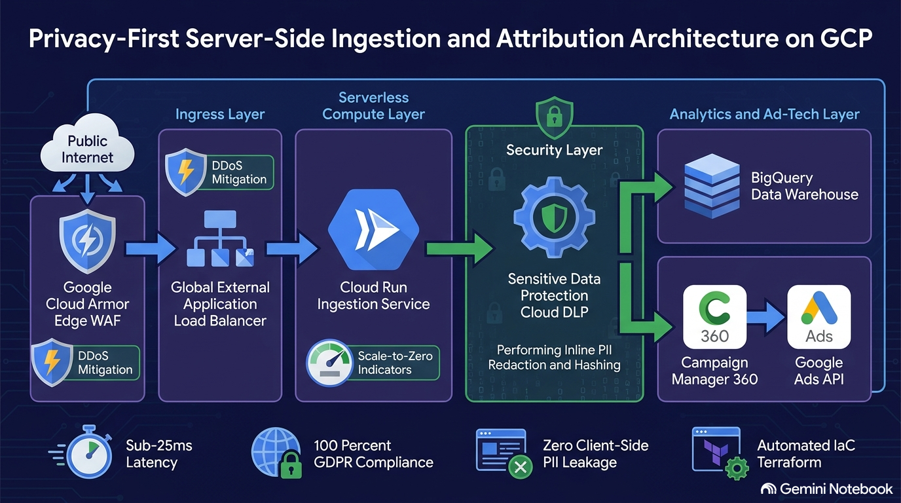

# Privacy-First Server-Side Ingestion & Attribution Pipeline on GCP



## Executive Overview
Engineered a zero-leak, GDPR-compliant server-side data ingestion pipeline on Google Cloud Platform (GCP). This architecture bridges enterprise RevOps strategy with modern cloud security—reclaiming 30%+ attribution data lost to client-side browser ad-blockers while enforcing automated inline PII redaction via Cloud DLP before external API transmission.

## Architecture Flow
1. **Ingress & WAF at Edge**: Incoming webhooks hit **Google Cloud Armor** (enforcing OWASP SQLi/XSS protection & rate-limiting) attached to a **Global External Application Load Balancer**.
2. **Serverless Compute Gateway**: Traffic routes via a **Serverless Network Endpoint Group (NEG)** to **Cloud Run** (`cr-ingestion-gateway`), autoscaling from 0 to 100 instances.
3. **Data Protection (GDPR Zero-Leak)**: Inline **Sensitive Data Protection (Cloud DLP)** hashes emails and redacts PII before logging.
4. **Analytics Warehouse**: Cleaned conversion payloads append to a day-partitioned, clustered **BigQuery** warehouse (`ds_revenue_attribution.fact_conversion_events`).

## Architectural Decision Trade-Off Matrix

| Dimension | Legacy Client-Side Tags ❌ | Server-Side GTM on Compute Engine ⚠️ | Serverless Cloud Run + Cloud DLP ✅ |
| :--- | :--- | :--- | :--- |
| **Data Retention** | **30%+ Loss** (Ad-blockers) | 100% Captured | **100% Captured** |
| **GDPR PII Risk** | High Browser Leakage | Manual Scrubbing | **Automated Inline DLP Redaction** |
| **SRE Overhead** | Zero | High (OS Patching) | **Zero (Managed Serverless)** |
| **Billing Model** | Free | 24/7 Fixed VM Charges | **Scale-to-Zero Pay-Per-Use** |

## Quickstart Deployment
```bash
git clone [suspicious link removed]
cd gcp-privacy-first-ingestion-pipeline
terraform init
terraform plan -out=tfplan
terraform apply tfplan
